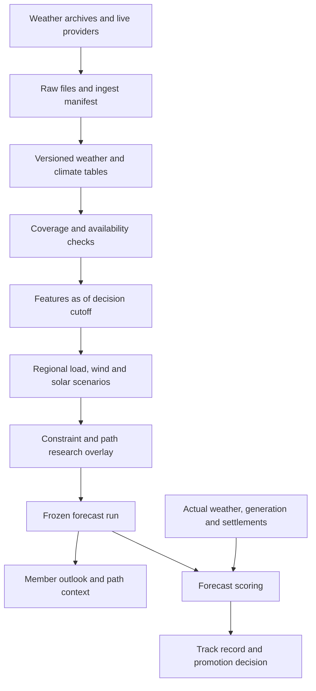

# Weather forecasting: workflow, SQL and UI

> **Status, 15 Oct 2026.** Built so far:
> - The forecast-vintage archive (`weather_forecast_vintages`, cradlehouse/ercotcron#5, live since 14 Oct). It's site-level and append-only, and run times are labelled by source.
> - Two pre-registered physical outlooks, NOV 2026 and JAN 2027 (`strategy/winter_outlook.py`, `docs/preregistrations/`). They use pinned ERA5 history, are frozen before delivery, and never touch bids.
>
> Everything else here is a proposal and isn't built. That covers the other tables, RPCs, `/app/outlook`, path overlays and the payoff layer. Agreed order from here:
> 1. Explain performance: one return definition, plus concentration attribution.
> 2. The generation-adjusted fade study on existing wind/solar actuals.
> 3. A narrow temperature/radiation backfill, only for what generation can't explain.
> 4. A few shadow experiments.
>
> Forecasting UI gets built only if those tests show useful incremental information.

Status: implementation specification, not deployed code. Complements the [research review](WEATHER_PREDICTIVE_REVIEW_2026-10-13.md) and [backfill plan](WEATHER_BACKFILL_PLAN_2026-10-13.md). All new table, module, RPC and route names below are proposed. The built archive is `weather_forecast_vintages` (one row per site series), not the `weather_forecast_values`/`weather_source_runs` split described below.

## Product outcome

For a selected delivery month and auction decision, show the weather outlook, what changed from the preceding month, expected load/renewable implications, affected constraints and paths, and measured forecast reliability. Preserve a frozen pre-auction prediction so the subsequent record scores the forecast actually available to the user.

The first release provides physical forecasts and a research overlay. Path-level dollar forecasts require separate validation. Published historical marks remain identifiable as the baseline throughout the comparison.

## End-to-end workflow

Use the existing Render scheduler in `ercot/jobs.py` and `ercot/service.py`. Do not add a second ingestion scheduler in Vercel. Backfills run through a resumable CLI with a database lease shared with live ingestion so overlapping writers cannot corrupt chunks; `max_instances=1` alone only protects one scheduler process.

| Job | Proposed cadence / trigger | Completion condition |
|---|---|---|
| Weather forecast collection | Hourly polling, deduplicated by source run/content | Required sites/variables have explicit coverage; raw response retained |
| Weather conditions collection | Daily, with a configurable revision lookback | Source lag respected and revisions preserved |
| Climate/ENSO collection | Daily polling for new publications | New release archived once with target periods and publication evidence |
| Daily regional features | After successful required inputs | Immutable input manifest and missingness summary recorded |
| Operational physical forecast | After a coherent required-input set arrives | Forecast horizon, model age and coverage pass configured checks |
| Month-ahead research forecast | Daily when inputs change; freeze for each auction decision | All inputs and model artifacts eligible at cutoff |
| Forecast scoring | Daily provisional; final after defined settlement maturity | Score includes outcome vintage and completeness |

A job succeeding with zero new rows can mean an unchanged publication, not an error. Distinguish unchanged, incomplete, unavailable and failed states. Do not publish a new forecast from incomplete inputs silently. Keep the previous valid run visible with its original timestamp and a stale status.

Run states: queued → collecting → validating → ready, or failed. Forecast states: draft → frozen; corrections create new linked runs. Publication/access state is separate from immutability. A frozen run cannot have its predictions or input manifest edited.

## SQL design

Use additive Supabase migrations. Retain existing tables and consumers during transition; historical overwritten rows cannot be relabeled as recovered original vintages. Enable RLS on every new table, with collector writes through the service role and application reads through authorized RPCs.

| Proposed table | Grain / key | Essential contents |
|---|---|---|
| `weather_sites` | Site ID | Coordinates, purpose, source grid metadata |
| `weather_region_weights` | Mapping version, region type, region, site, effective start | Weight, effective end, publication evidence; distinguish load/wind/solar geographies |
| `weather_ingest_batches` | Batch ID; unique source/request/content identity | Raw object URI/hash, requested period, retrieval time, row counts, status, errors, coverage |
| `weather_source_runs` | Source/model/run identity and revision | Initialization, publication time, availability evidence, first-seen time, raw batch |
| `weather_forecast_values` | Source run, member, site, valid time, variable | Value and canonical unit; deterministic member uses an explicit sentinel |
| `weather_condition_values` | Source, site, valid time, variable, revision | Observation/reanalysis type, value/unit, publication evidence and ingest batch |
| `climate_outlook_releases` | Source/release/revision | Issue and availability time, raw provenance, index definition |
| `climate_outlook_values` | Release, geography, target start/end, variable/category | Category probability or quantitative index; qualitative text separately |
| `ercot_forecast_vintages` | Product, geography, valid time, posted time, source revision | Forecast metric values, availability evidence and batch |
| `weather_feature_snapshots` | Snapshot ID | Cutoff, target period, feature/mapping versions, source manifest, training eligibility |
| `weather_feature_values` | Snapshot, geography, feature | Value/unit, coverage, lag/window and missing reason |
| `weather_model_versions` | Model version | Artifact URI/hash, code version, training cutoff, features, calibration and validation record |
| `weather_prediction_runs` | Run ID | Decision cutoff, delivery month, snapshot/model IDs, baseline version, frozen timestamp, status and superseded run |
| `weather_prediction_values` | Run, target/geography, metric, quantile or scenario | Value/unit, scenario identity/weight where applicable |
| `weather_path_overlays` | Run, source, sink, instrument, TOU, delivery month | Baseline, eligible weather forecast/range, direction, explanatory drivers, evidence status |
| `weather_prediction_scores` | Run, metric, evaluation period, outcome version | Error/calibration score, baseline comparison, sample size, provisional/final status |

Retain actual ERCOT outcomes in existing outcome tables where suitable; a forecast-vintage table is not a substitute for a missing historical actual-load feed. Audit actual-load availability before fitting or scoring load models.

Constraints: unique source identities for idempotence; nonnegative coverage counts; probabilities within [0,1]; complete category sets sum to one within tolerance; valid interval bounds; explicit units; ordered stored quantiles. Do not manufacture zero values for absent observations. Handle source corrections with revision rows and link to the superseded release.

Indexes: forecast `(site_id, variable, valid_time, source_run_id)`; source runs `(source, model, available_at)`; conditions `(site_id, variable, valid_time, revision)`; prediction runs `(delivery_month, decision_cutoff)`; overlays `(run_id, source_point, sink_point, tou)`. Measure volume before partitioning; if needed, partition hourly values by valid month and include that partition key in uniqueness constraints.

Raw bulk responses and model artifacts belong in private object storage. SQL stores normalized values, compact manifests, lineage and application summaries. Large scenario ensembles can live in versioned files with hashes referenced by runs.

### As-of selection contract

An eligible record must have valid source-availability evidence at or before the cutoff. Model initialization alone is insufficient. Backfilled rows use historical publication evidence, not today's retrieval timestamp. Unknown availability is excluded from exact historical forecasting claims; conservative estimates must be labeled and tested separately.

Select the most recent eligible source run per model, then all its applicable horizon values. Do not mix later and earlier runs per hour merely to fill holes. Missing horizon values remain missing or use an explicitly versioned fallback. Record selected run IDs in the snapshot so reconstruction never depends on a mutable latest view.

Planned SQL interfaces:

- Internal `weather_forecasts_asof(cutoff, horizon_start, horizon_end)` and `climate_outlooks_asof(cutoff, target_start, target_end)` enforce selection rules.
- `get_weather_outlook(delivery_month, run_id)` returns a compact summary and provenance; omitted run ID selects the latest eligible published run.
- `get_weather_path_context(run_id, source_point, sink_point, tou)` returns the matched overlay and evidence status.
- `get_weather_forecast_record(delivery_month)` returns frozen predictions and versioned scores.
- `get_weather_pipeline_health()` is admin-only and reports source lag, missing coverage and failures.

Follow the existing member RPC authorization pattern and `lib/rpc.ts` wrapper. Check active plan and access inside SQL, not only in React. Restrict research runs to authorized research/admin users until released. If using security-definer functions, fix the search path, qualify objects, restrict execution grants and test cross-user access. Book-level results must enforce ownership.

## Adding forecasting

Implement research computation in new `strategy/weather_features.py`, `strategy/weather_models.py`, `strategy/weather_forecast.py` and `strategy/weather_score.py` modules, with collectors in `ercot/` and a resumable `scripts/backfill_weather.py`. Keep training out of request handlers and lightweight ingest workers; deploy immutable trained artifacts for routine prediction.

1. **Features:** prior 7/30/60 days and latest complete month, target-month seasonality, degree days, humidity, radiation, wind and land conditions; account for release delays. Store month-to-date separately. All feature scaling and selection come from training data.
2. **Physical models:** start with interpretable nonlinear regional load response, calibrated wind conversion and radiation-to-solar response. Include available capacity, calendar and trend. Compare against climatology and ERCOT forecasts where horizons overlap.
3. **Horizon-specific forecasts:** operational weather supports days ahead; subseasonal/seasonal guidance supports weekly/monthly distributions. Do not extrapolate seven-day forecasts into a detailed hourly month prediction. If hourly scenario paths are needed, sample weather sequences conditional on monthly guidance and label them simulated scenarios.
4. **ENSO contribution:** test antecedent-only, seasonal-only and combined models. Add ENSO only if it improves held-out results beyond seasonal guidance. Preserve covariance among load, wind and solar by using matched scenario members or joint sampled sequences.
5. **Net load:** calculate load minus wind minus solar inside each scenario, then compute quantiles. Subtracting separately calculated component quantiles does not give a net-load quantile.
6. **Constraint/path layer:** estimate weather-conditioned binding activity with topology/outage controls. Use existing exposure evidence only within its validated scope. Until magnitude is validated, display directional pressure and uncertainty rather than invented dollar adjustments.
7. **Payoff layer, when supported:** apply source/sink direction, instrument and ERCOT TOU rules to each scenario's relevant congestion outcomes before aggregation. Option expected payoff cannot be obtained by flooring the expected spread. Keep common energy-price movements distinct from path congestion.
8. **Scoring:** use the exact frozen run against outcome vintages; evaluate MAE/bias for physical means, pinball loss/coverage for quantiles, and probability calibration for events. Score monthly path outcomes against the unchanged baseline and separately report realistic fill/cost assumptions for auction experiments.

Existing `strategy/valuation.py` and `strategy/marks.py` remain separate baseline implementations; pin the appropriate version for each comparison rather than assuming their rules are identical. The existing `net_load` view uses latest stored fundamentals and must not serve as an as-of backtest input.

## UI and user workflow

Add a member route `/app/outlook`, accessible from a concise Outlook card on `/app`. Initially expose research runs only to authorized research users. Use existing styling, chart interactions and provenance components. Browser code reads summarized RPC outputs; it does not download raw multi-year weather records.

Page flow:

1. **Choose delivery month and forecast:** default to the relevant auction month; show forecast date, decision cutoff, live versus frozen status, input coverage and stale/insufficient-data state.
2. **Read the forecast:** regional load/wind/solar and net-load ranges, with clear units and horizon. Seasonal category probabilities remain probabilities, not degree or MW changes without a calibrated conversion.
3. **See what changed:** compare prior-month weather, the earlier forecast and the current forecast. Explain drivers such as reduced expected solar or higher heating demand. Separate changing source guidance from a model-version change.
4. **Inspect path relevance:** show existing baseline alongside research direction/range, relevant constraints and evidence level. Unsupported paths display “insufficient evidence,” not a zero adjustment.
5. **Check the record:** compare the frozen outlook with realized outcomes and the baseline. Show completed delivery-month count, calibration and missing coverage; provisional months are identified.

Integrations:

- `/bids`: a compact weather-context indicator links to the exact forecast run. Research indicators do not silently alter bid limits or CSV exports.
- `/path`: delivery-month weather context explains directional drivers and uncertainty for the selected path.
- `/app/book`: aggregate exposure across common scenarios after ownership checks. Do not add path quantiles as if that were a portfolio quantile.
- `/app/record`: separate weather forecast performance from published bid-sheet performance.
- `/health` or an admin section: source freshness, backfill progress, missing sites, forecast eligibility and last successful scoring run.

Model IDs, raw hashes and source manifests belong in expandable provenance, not the primary decision flow. The main screen should answer: what changed, how does it affect this month/book, and how reliable has that prediction been?

## Delivery sequence and acceptance

| Slice | Work | Acceptance |
|---|---|---|
| 1. Data foundation | Additive schema, storage, collectors, backfill CLI and health summary | Retry/restart is idempotent; revisions preserved; coverage and publication evidence auditable |
| 2. Prior-month study | Features and weather-adjusted fade comparison | No future leakage; explicit market overlap and held-out result, including failure to improve |
| 3. Physical forecasts | Regional models, immutable runs, scoring and admin outlook | Reproducible forecast from pinned inputs/artifact; calibrated ranges and missing-data behavior checked |
| 4. Monthly shadow overlay | Seasonal/ENSO inputs, constraint context and auction freeze | Comparison with baseline frozen before decision; appropriate independent-month/event evaluation |
| 5. Member integration | Outlook, path/book links and forecast record | RPC authorization, stale/empty/error states, mobile usability and performance verified |
| 6. Promotion | Versioned methodology change if evidence supports it | Predeclared improvement criteria met; forecast can be disabled without losing historical record |

Tests should cover actual failure modes: late publications, source revisions, mixed model ages, duplicate chunks, DST/TOU, missing sites, future-data exclusion, frozen-row mutation, role/ownership checks, and consistent scenario aggregation. Use the existing Python/Postgres/TypeScript checks as applicable. Record promotion criteria before looking at the final held-out results; do not invent acceptance thresholds after observing the winner.

Rollback: disable the overlay publication/consumption flag and return consumers to the pinned baseline. Preserve archived inputs, frozen forecasts and scores so rollback cannot erase a failed experiment.
